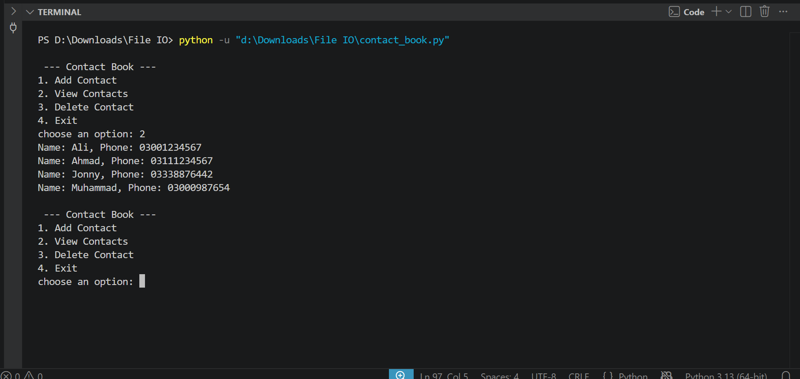

# 📇 Contact Book in Python

A command-line contact manager built with Python. Store names, phone numbers and emails, search and edit them, and export everything to CSV. Data is saved automatically to a JSON file.


## Demo



## Features

- ➕ Add contacts with phone number and optional email
- 📋 View all contacts, sorted alphabetically
- 🔍 Search by name, phone or email
- ✏️ Update an existing contact
- 🗑️ Delete contacts (with confirmation)
- 📤 Export contacts to CSV
- ✅ Phone and email validation
- 🔠 Case-insensitive names ("Ali" and "ali" are the same contact)
- 💾 Automatic JSON storage, with old save files upgraded automatically
- 🛡️ Handles missing or corrupted JSON files gracefully

## How to Run

```bash
git clone https://github.com/ilyasxhan/contact-book-python.git
cd contact-book-python
python contact_book.py
```

No external libraries needed — only the Python standard library.

## Sample Menu

```text
--- Contact Book ---
1. Add Contact
2. View Contacts
3. Search Contacts
4. Update Contact
5. Delete Contact
6. Export to CSV
7. Exit
```

## Running Tests

```bash
pip install pytest
python -m pytest
```

## Project Structure

```text
contact-book-python/
├── contact_book.py        # the app
├── test_contact_book.py   # tests (pytest)
├── contact-book-demo.png  # screenshot for this README
├── README.md
├── LICENSE
└── .gitignore
```

`contacts.json` and `contacts.csv` are created when you run the app and are not tracked by git.

## Concepts Practiced

- Functions and dictionaries
- JSON and CSV file handling
- Custom exceptions and `try` / `except`
- Input validation with regular expressions
- Menu-driven program design using a dispatch dictionary
- Unit testing with pytest

## Future Improvements

- Store contacts in SQLite instead of JSON
- Add birthdays and reminders
- Build a GUI with Tkinter or a web version with Flask

## Author

**Muhammad Ilyas Khan** — [github.com/ilyasxhan](https://github.com/ilyasxhan)
